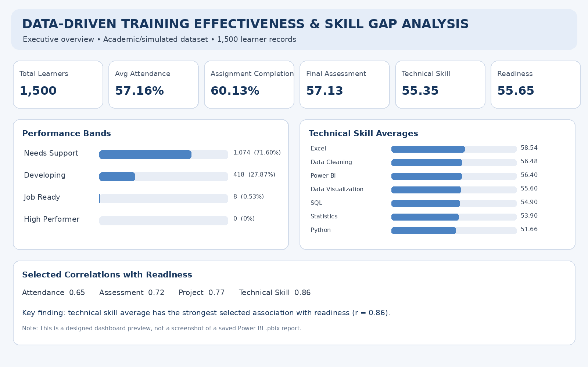
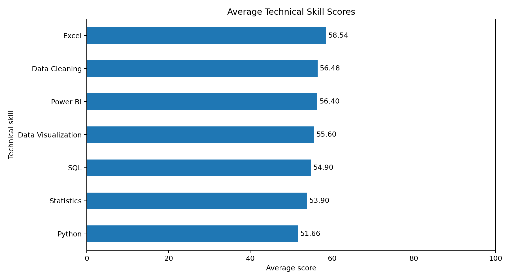
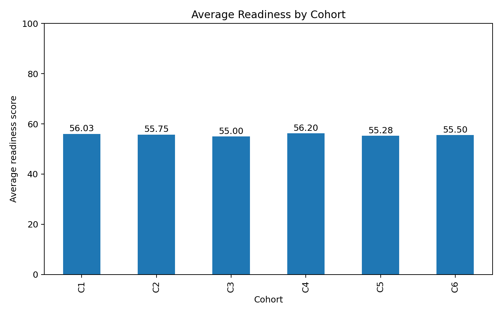
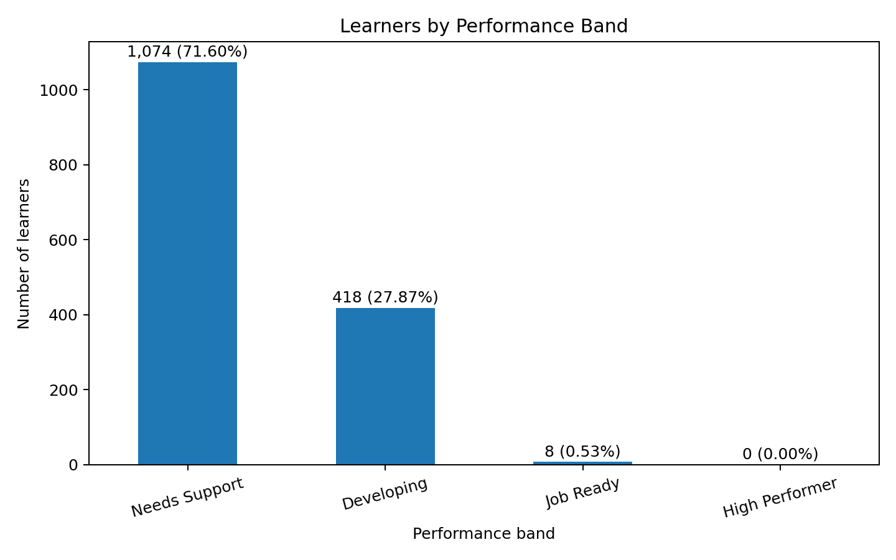
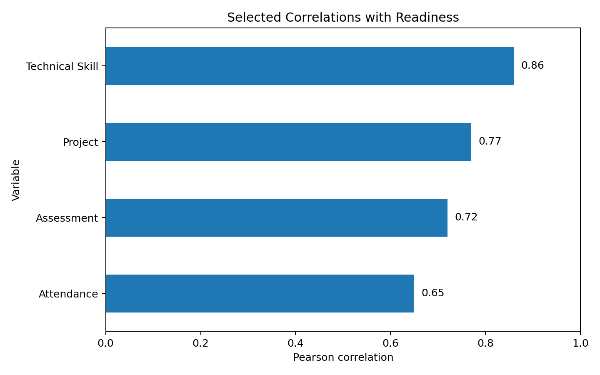

# Data-Driven Training Effectiveness and Skill Gap Analysis

**Student:** Keshav Sood  
**Programme:** MBA — Chandigarh Engineering College, Jhanjeri  
**Organization:** SkillInfyTech IT Solutions Pvt. Ltd.  
**Internship area:** Data Analytics  
**Internship period:** 12 June 2026 – 07 August 2026 (8 weeks)

## Project overview
This portfolio project demonstrates a structured data analytics workflow for evaluating learner participation, assignment completion, assessments, project performance, technical skills, readiness, performance bands and training-completion indicators.


## Tools and workflow
**Excel → MySQL → Python (Pandas, Matplotlib) → Power BI**

- **Excel:** data inspection, KPI calculations and cohort summaries
- **MySQL:** filtering, aggregation and grouped queries
- **Python:** summary analysis and visualizations
- **Power BI:** dashboard-oriented reporting design

## Key project outputs
- 1,500 records and 35 variables
- KPI analysis
- Cohort-wise readiness comparison
- Technical skill average and skill-gap calculations
- Performance-band distribution
- Completion and support status
- Selected correlation analysis
- Dashboard-oriented executive preview

## Report-based visuals

### Executive dashboard preview


*Designed preview based on the report values; not a screenshot of a saved Power BI `.pbix` file.*

### Technical skill averages


### Cohort readiness


### Performance bands


### Selected correlations with readiness


## Repository structure
```text
data/
  training_effectiveness_1500_records.csv
  training_effectiveness_1500_records.xlsx
  data_dictionary.csv
  project_kpi_summary.csv
python/
  analysis.py
sql/
  analysis_queries.sql
images/
  executive_dashboard_preview.png
  technical_skill_averages.png
  cohort_readiness.png
  performance_bands.png
  correlation_with_readiness.png
report/
  Internship_Report_Data_Driven_Training_Effectiveness.docx
  Internship_Report_Data_Driven_Training_Effectiveness.pdf
documentation/
  PROJECT_WORKFLOW.md
requirements.txt
.gitignore
```

## Run the Python analysis
1. Install Python 3.10 or later.
2. Open a terminal in this repository.
3. Install dependencies:
   ```bash
   pip install -r requirements.txt
   ```
4. Run:
   ```bash
   python python/analysis.py
   ```

The script reads the CSV, prints KPI and cohort summaries, and creates additional charts under `images/generated/`.

## SQL
Import the CSV into MySQL Workbench as `training_effectiveness`, then run the relevant queries in `sql/analysis_queries.sql`. Confirm imported column names before execution.

## Power BI
Import the CSV or Excel workbook into Power BI Desktop. Suggested visuals:
- KPI cards
- Cohort readiness bar chart
- Technical skill averages
- Performance band distribution
- Completion status
- Slicers for cohort, training mode, location and performance band

A `.pbix` file is not included because no saved Power BI file was available. The executive preview image is clearly labelled as a designed preview.

## Important interpretation notes
- The dataset is simulated for academic demonstration.
- Performance bands and readiness logic are project-defined.
- Correlation indicates association, not causation.
- Future operational use would require approved anonymized data and validation.

## Skills
Data Analytics · Excel · MySQL · SQL · Python · Pandas · Matplotlib · Power BI · KPI Analysis · Skill Gap Analysis · Data Visualization · Correlation Analysis
